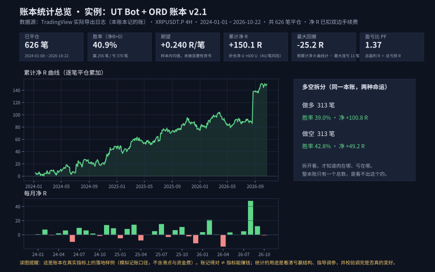

# ORD Ledger Template for Pine Script · Pine 指标逐笔账本模板

> 给任何 TradingView Pine 指标加一本**可导出、可逐笔对账**的账：首行参数自证（CFG）、
> 每笔平仓一行（ORD）、数据末端未平仓快照（HOL）。
> *Add an exportable, reconcilable per-trade ledger to any Pine Script indicator.*

**版本：v1.0 · 2026-10-22 定稿发布。** 账本已在两个真实指标上落地，并都完成了
TradingView ↔ Python 引擎的逐笔校准（实证数字见下方「已落地实例」）。

---

## 先说用途：它是给指标作者打磨指标用的

**一句话：这本账不是用来看的，是用来改指标的。**

设计者的初衷就一个：**把自己的指标摊开看清楚 — 到底亏在哪、赢在哪 —
然后照着数据一格一格调，把胜率和盈亏比磨上去。**

没有账的时候，调指标只能靠看图和感觉：图上的信号个个像模像样，
可那多半是行情走完之后的事后视角。有了逐笔账，调参变成一个闭环：

1. **记账** —— 每笔的开/平仓价、退出原因、盈亏 R，全部落纸，一笔不漏；
2. **统计** —— 按方向、时段、退出原因、信号类型拆开看：哪一类在赚钱、哪一类在送钱；
3. **改一处** —— 一次只动一个参数或一条规则；
4. **再记账验证** —— 同口径再跑一遍，数字真的变好了才算数，没变好就退回去。

这不是设想，是这本账在真实项目里已经干过的事：

- 靠逐笔对账查出：TV 上正在跑的实例用的根本不是源码默认参数
  （止损回看 14 / 缓冲 0.3，而源码默认是 5 / 0.2）—— 只看图永远发现不了；
- 靠分组统计发现：一个被寄予厚望的进场区域（OTE 最佳进场区）其实在帮倒忙，
  带它的单明显更差 — 于是把它从信号里拿掉，只留作画图参考；
- 靠拆灯统计发现：一套 14 分评分系统里，真正有区分度的只有两盏灯，
  其余多是把同一件事重复计数 — 评分该怎么改，账说了算；
- 靠出场统计定下：TP1 定在 1.0R、触发后移保本是这组数据的甜点，
  而不是拍脑袋定的 2R、3R。

账本导出之后，能算出的统计长这样（**真实日志、真实数字，不是演示数据**）：



> 图：UT Bot + 本账本 v2.1 在 TradingView 上的实际导出（XRPUSDT.P 4H，
> 2024-01-01 ~ 2026-10-22，共 626 笔平仓，净 R 已扣双边手续费）。
> 注意它的胜率只有 40.9% — 胜率低不等于亏钱：期望 +0.240 R/笔靠的是
> 盈亏比（PF）1.37。这正是统计的价值：把「感觉行不行」换成
> 「哪一项行、哪一项不行、该动哪一格」。此图为导出全窗；
> 下方「已落地实例」里的 613 笔是校准窗（截至 2026-09-30），口径不同、都是真账。

---

## 这是什么

一段可以整段粘贴进任意 `indicator()` 脚本的 Pine v6 代码块（`ord_ledger_template.pine`）。
宿主指标只需在自己的**信号 / 开仓 / 平仓**事件处各调用一个函数：

```pine
f_ord_signal(dir)                        // 信号登记（计数）
f_ord_open(dir, px, rDist, time_close)   // 开仓登记
f_ord_close(px, "退出原因", time_close)  // 平仓登记 → 输出一行 ORD
```

账本在运行时把每笔模拟交易写成 CSV 行，经 Pine 日志（`log.info`）导出。
文件自带一个最简演示宿主（EMA 交叉），可直接加到图表上看它工作；
接入步骤、R 距离的四种常见定义、口径与常见坑，见 [INTEGRATION_GUIDE.md](INTEGRATION_GUIDE.md)。

## 为什么要给指标留一本账

**先有账，再谈信号。**

- TradingView 对 `strategy()` 有内置的策略测试器逐笔清单，但对 `indicator()` 什么都不给：
  没有记账、没有清单、没有回测。绝大多数指标做到「画信号 + 一个胜率面板」就封顶了，
  而面板口径往往宽松（例如「先触达 TP1 即算赢」），数字系统性偏乐观。
- **指标自带一本能导出的逐笔账本，是稀有配置。** 有了它，指标在 TV 上的每一笔
  （开仓价、平仓价、退出原因、折算 R）都能拿去和外部回测引擎逐笔对齐 ——
  对得上，引擎的数字才算数；对不上，账本会告诉你错在哪一笔、差多少。
- 这套设计的原型来自一个真实项目的校准实践：靠这本账，逐笔对齐做到 39/42 笔
  进场价分毫不差，并查出了「TV 实例实际参数与源码默认值不一致」这类
  只看图永远发现不了的问题。设计者的背景是销售平台数据统计 ——
  业务系统的老规矩：**没有可对账的流水，出了事连错在哪都查不到。** 把这条搬进指标，仅此而已。

## 格式规范

时间一律 **UTC**、记 K 线**收盘时刻**（`time_close`），格式 `yyyy-MM-dd HH:mm`。
价格 6 位小数，R 4 位小数，U 2 位小数。

### CFG — 首行，参数自证（脚本运行第一根打印一次）

`CFG,脚本={名},账本=ORD模板v1.0,图表周期={周期},蜡烛=真实K线,口径={出场口径},R定义={R距离定义},手续费={费率}%/边,净U=净R*{每笔风险}U,时间=UTC收盘时刻,数据首根={首根时间}`

逗号分隔的 `k=v` 串。对账工具至少读取 `图表周期` 与 `数据首根` 两键；
宿主可在行尾追加自己的参数（如砚舟的评分模式、UT Bot 的 KV/ATR 周期），不影响解析。

### ORD — 每笔平仓一行（共 14 段）

| # | 字段 | 含义 |
|---|---|---|
| 1 | `ORD` | 行类型标记 |
| 2 | 编号 | 单号，开仓时自增 |
| 3 | 方向 | `多` / `空` |
| 4 | 开仓时间 | 开仓根收盘时刻（UTC） |
| 5 | 平仓时间 | 平仓根收盘时刻（UTC） |
| 6 | 开仓价 | 宿主口径的成交价 |
| 7 | 平仓价 | 同上 |
| 8 | 退出原因 | 宿主自由文本，如 `翻转` / `止损` / `止盈`（勿带逗号） |
| 9 | R距离 | 开仓时锁定的 R 距离（价格单位） |
| 10 | 毛R | `(平仓价 − 开仓价) × 方向 / R距离` |
| 11 | 手续费R | `费率 × (开仓价 + 平仓价) / R距离` |
| 12 | 净R | 毛R − 手续费R |
| 13 | 净U | 净R × 每笔计划风险（默认本金 400U × 1% = 4U） |
| 14 | 持仓根数 | 平仓根 − 开仓根（bar 数） |

表头行（打印一次，解析时跳过）：
`ORD,编号,方向,开仓时间,平仓时间,开仓价,平仓价,退出原因,R距离,毛R,手续费R,净R,净U,持仓根数`

### HOL — 数据末端未平仓快照（共 8 段）

| # | 字段 | 含义 |
|---|---|---|
| 1 | `HOL` | 行类型标记 |
| 2 | 编号 | 当前持仓单号 |
| 3 | 方向 | `多` / `空` |
| 4 | 开仓时间 | 开仓根收盘时刻（UTC） |
| 5 | 开仓价 | 同 ORD |
| 6 | R距离 | 同 ORD |
| 7 | 最新收盘 | 最后一根收盘价 |
| 8 | 未实现净R | 按最新收盘折算的净 R（已扣双边手续费） |

同一单号每根最新 K 线最多一行，对账取最后一行；已出现在 ORD 中的单号，其 HOL 忽略。
表头行：`HOL,编号,方向,开仓时间,开仓价,R距离,最新收盘,未实现净R`

解析约定（供写对账工具的人）：按行首标记 `CFG,` / `ORD,` / `HOL,` 分发；
ORD 必须恰为 14 段、HOL 恰为 8 段，不符则报警跳过；时间为 UTC 收盘时刻，
与记开始时刻的引擎对账时按 `引擎时刻 = TV 时刻 − 图表周期` 换算。

## 已落地实例

| 实例 | 说明 | 链接 |
|---|---|---|
| SMC 全战法 · 砚舟 v4 | 账本的原型出处。Ticket 制多字段扩展版（方向/等级/评分/补仓/MFE/MAE 等 30+ 列）。校准实证：与 Python 引擎 39/42 笔逐笔配对、配对单进场价差为 0，并据账查出 TV 实例实际参数（14/0.3）与源码默认值（5/0.2）不一致的根源问题 | （待补：发布时填链接） |
| UT Bot + ORD 账本 v2.1 | 本模板标准字段集的来源：QuantNomad 的 UT Bot（MPL-2.0）逻辑本体 + 本账本，强制真实蜡烛、翻转出场口径，配套有逐笔对账工具。校准实证（2026-10-22 通过）：窗内 614 笔与同窗引擎配对率 100%、真分歧 0；613 对双方真实平仓单的入场价差、出场价差 613/613 全为 0.000000；双源净 R 同为 +150.9864R | （待补：发布时填链接） |

> 校准证明的是「账记得对、引擎算得对」，不是任何指标能盈利的证明 —— 别把对账通过当成赚钱背书。

## 许可

- **账本模板本身**（`ord_ledger_template.pine` 的模板区块及本仓库文档）：**MIT** ——
  随便用、随便改，保留出处声明即可。全文以仓库根目录 `LICENSE` 文件为准。
  中文译文见 [LICENSE_zh.md](LICENSE_zh.md)（仅供参考，以英文原文为准）。
- **宿主指标的逻辑各归其主**：套用本模板不改变宿主脚本原有的许可与版权；
  例如 UT Bot 本体为 QuantNomad 作品、遵循 MPL-2.0，使用时请保留其出处与许可声明。
- 本模板只做记账与导出，不构成任何交易建议；账本数字为模拟口径，不含滑点。

## 路线图

- [x] UT Bot 版完成 TV 逐笔校准 → 模板定稿 v1.0（2026-10-22）
- [ ] 在 TradingView 以开源公开脚本形式发布演示指标（模板 + 演示宿主）—— 步骤见 `PUBLISH_GUIDE.md`
- [ ] 视反馈考虑：多仓/Ticket 制扩展版式、多笔分批平仓的 PART 行
